# VisionBench

A local platform for **reproducible image-classification benchmarking with explainability**:
import and audit a dataset, split it without leakage, train baseline and CNN models, evaluate
with confidence intervals, compare runs, inspect single predictions with Grad-CAM, and measure
robustness under fixed image corruptions. You can use it from a web UI, a REST API or the CLI.
Every number carries the split it came from.

It ships with one frozen, pre-registered benchmark, `eurosat-v1`:
- the data is EuroSAT RGB;
- the runs are 5 models × 3 seeds;
- the checkpoints were selected on VALIDATION only;
- the TEST split is evaluated exactly once, following a committed analysis plan.

> **Status: `v1.0.0`.** The eurosat-v1 TEST split has been evaluated once, per the committed
> plan (with one procedural amendment); see [Results](#results-eurosat-v1) and
> [FINAL_REPORT.md](benchmarks/eurosat-v1/results/FINAL_REPORT.md). Every number is labelled
> TEST or VALIDATION (selection-biased).

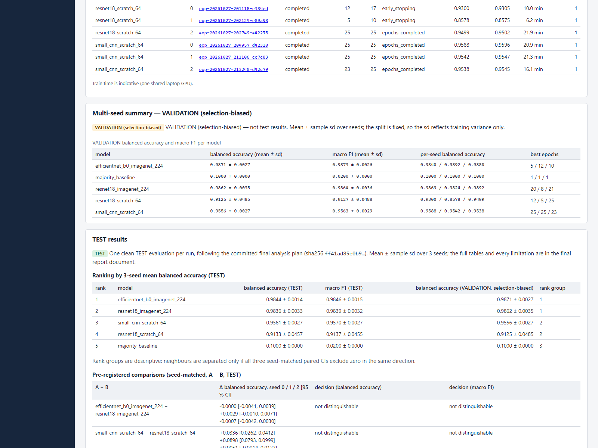

Contents:
- [Architecture](#architecture)
- [Quick Start](#quick-start)
- [Results](#results-eurosat-v1)
- [The web app](#the-web-app)
- [Datasets](#datasets) · [Training](#training) · [Evaluation](#evaluation-and-comparison)
- [Reproduce the benchmark](#reproduce-the-eurosat-v1-benchmark)
- [API](#api)
- [Docker](#docker)
- [Configuration](#configuration)
- [Development](#development)
- [Troubleshooting](#troubleshooting)
- [Limitations](#limitations)
- [License and attribution](#license-and-attribution)

## Architecture

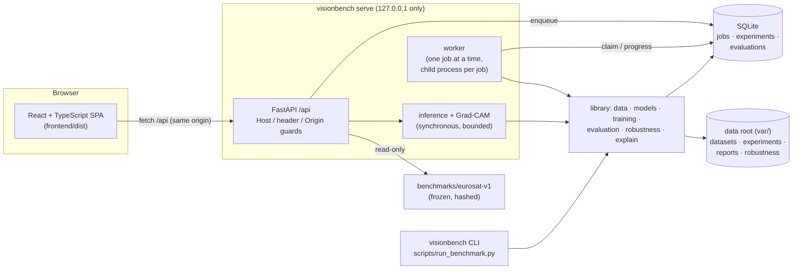

- **Library first:** the CLI, the worker and the API call the same library.
  - The API never does ML work inside a request. The only exception is single-image
    prediction and Grad-CAM, which is bounded and CPU by default.
  - Training, evaluation, imports and robustness run as queued jobs, with progress, cancel and
    crash recovery.
- **Only `visionbench.evaluation` reads TEST images.**
  - Every TEST evaluation is recorded and counted.
  - A second TEST evaluation of the same checkpoint needs `--force --reason`.
  - TEST images are locked in the app until the final evaluation.
- Details: [ARCHITECTURE.md](ARCHITECTURE.md). Methodology: [EXPERIMENT_PROTOCOL.md](EXPERIMENT_PROTOCOL.md).

## Quick Start

Both routes use a **synthetic demo dataset**: coloured shapes generated locally, not EuroSAT.
Numbers from it are pipeline sanity checks, not results.

### A. Docker (CPU)

```sh
git clone <this repository> VisionBench
cd VisionBench
docker compose up --build -d          # first build downloads CPU PyTorch (~200 MB)
docker compose exec visionbench visionbench demo-data /data/demo
docker compose exec visionbench visionbench dataset import /data/demo/shapes --name demo-shapes
```

Open <http://127.0.0.1:8000>. Then, in the app:
1. **Datasets** → the dataset → **Create split**;
2. **Training** → `small_cnn`, input size 32, a few epochs, device `cpu` → **Start training**;
3. **Evaluate & Compare** → **Start VAL evaluation**;
4. **Explain** → pick an image → **Predict** / **Grad-CAM**.

`docker compose down` stops the container. Data stays in the `visionbench-data` volume (add `-v`
to delete it).

### B. Native (Python 3.11; Windows PowerShell shown, see the note for Linux/macOS)

Needs Python 3.11 and Node.js 22 (for building the frontend). Below, `py -3.11` stands for any
Python 3.11 interpreter (for example the full path to its `python.exe`).

```powershell
git clone <this repository> VisionBench
cd VisionBench
py -3.11 -m venv .venv
.\.venv\Scripts\python.exe -m pip install --upgrade pip
.\.venv\Scripts\python.exe -m pip install torch==2.14.1 torchvision==0.29.1 --index-url https://download.pytorch.org/whl/cpu
.\.venv\Scripts\python.exe -m pip install -e ".[dev]"
cd frontend; npm ci; npm run build; cd ..
.\.venv\Scripts\visionbench.exe demo-data var\demo
.\.venv\Scripts\visionbench.exe dataset import var\demo\shapes --name demo-shapes
.\.venv\Scripts\visionbench.exe serve            # from the repository root
```

Open <http://127.0.0.1:8000> and continue as in A. On Linux/macOS:
- use `python3.11 -m venv .venv`;
- use `.venv/bin/python` and `.venv/bin/visionbench`;
- use `cd frontend && npm ci && npm run build && cd ..`.

For a CUDA build, see [Setup with CUDA](#setup-with-cuda).

The demo dataset is small (3 classes × 40 images, 32 × 32 px). Train `small_cnn` with
`input_size` 32, or `majority_baseline`; pretrained models resize to 224 px and are slow on CPU.

## Results (eurosat-v1)

EuroSAT RGB, one fixed leakage-aware split (4,050 TEST images), 5 models × 3 seeds, one clean
TEST evaluation per run of the VAL-selected checkpoint, analysed exactly as pre-registered in
[FINAL_ANALYSIS_PLAN.md](benchmarks/eurosat-v1/FINAL_ANALYSIS_PLAN.md). Full tables, per-run
CIs and every limitation: [FINAL_REPORT.md](benchmarks/eurosat-v1/results/FINAL_REPORT.md).

| rank | model | balanced accuracy (TEST) | macro F1 (TEST) | balanced accuracy (VALIDATION, selection-biased) | rank group |
|---|---|---|---|---|---|
| 1 | efficientnet_b0_imagenet_224 | 0.9844 ± 0.0014 | 0.9846 ± 0.0015 | 0.9871 ± 0.0027 | 1 |
| 2 | resnet18_imagenet_224 | 0.9836 ± 0.0033 | 0.9839 ± 0.0032 | 0.9862 ± 0.0035 | 1 |
| 3 | small_cnn_scratch_64 | 0.9561 ± 0.0027 | 0.9570 ± 0.0027 | 0.9556 ± 0.0027 | 2 |
| 4 | resnet18_scratch_64 | 0.9133 ± 0.0457 | 0.9137 ± 0.0455 | 0.9125 ± 0.0485 | 2 |
| 5 | majority_baseline | 0.1000 ± 0.0000 | 0.0200 ± 0.0000 | 0.1000 ± 0.0000 | 3 |

Mean ± sample sd over seeds 0, 1, 2 (the split is fixed, so the sd is training variance only).

**Pre-registered comparisons** (seed-matched paired bootstrap of A − B; "distinguishable" only if
all three seeds' 95 % CIs exclude zero in the same direction):

| A − B | decision (balanced accuracy and macro F1) |
|---|---|
| efficientnet_b0_imagenet_224 − resnet18_imagenet_224 | not distinguishable |
| small_cnn_scratch_64 − resnet18_scratch_64 | not distinguishable (seed 2's CI includes zero) |
| resnet18_imagenet_224 − resnet18_scratch_64 | distinguishable: resnet18_imagenet_224 > resnet18_scratch_64 |

**Robustness (TEST, 12 synthetic corruption conditions):** mean corrupted balanced accuracy
ranges from 0.4372 (efficientnet_b0) to 0.5869 (resnet18_scratch); the models with the highest
clean accuracy lose the most under these corruptions. Tables:
[robustness_test.md](benchmarks/eurosat-v1/results/robustness_test.md). No model is called
robust.

**How to read this:**
- Pretraining and input resolution are confounded (224 px pretrained vs 64 px scratch), so
  comparison 3 cannot attribute the difference to either.
- One split, n = 3 seeds, a 25-epoch cap and untuned learning rates: the numbers describe these
  budgets on EuroSAT RGB, not each architecture's best accuracy.
- VALIDATION numbers chose the checkpoints and are selection-biased.
- **Amendment 1 (procedural):** the corrupted-image cache path gained the split name after the
  first TEST materialization pass collided with the VAL cache; nothing else changed, no
  robustness TEST result existed then, and the 15 clean TEST evaluations were not redone.

## Screenshots

Genuine screenshots of the app on the real data root (1600 × 1200):

| | |
|---|---|
| 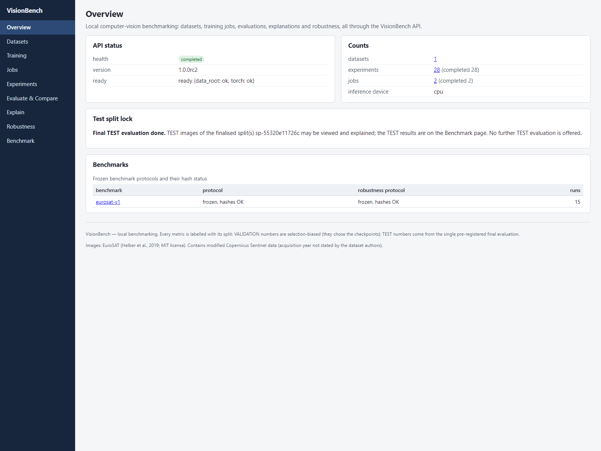 | 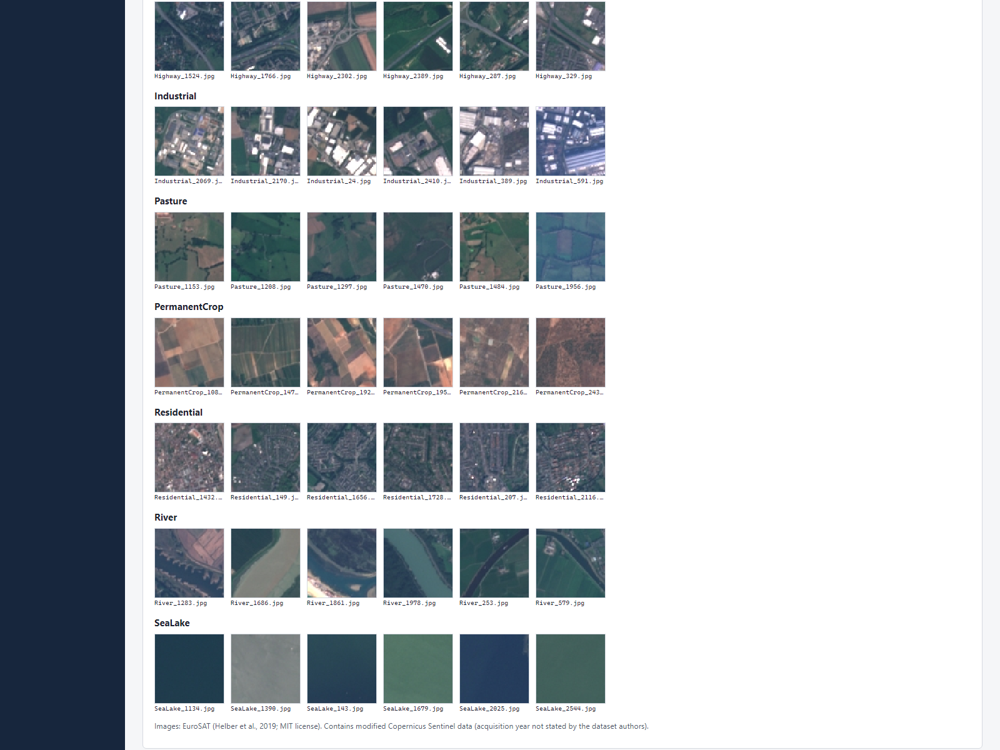 |
| 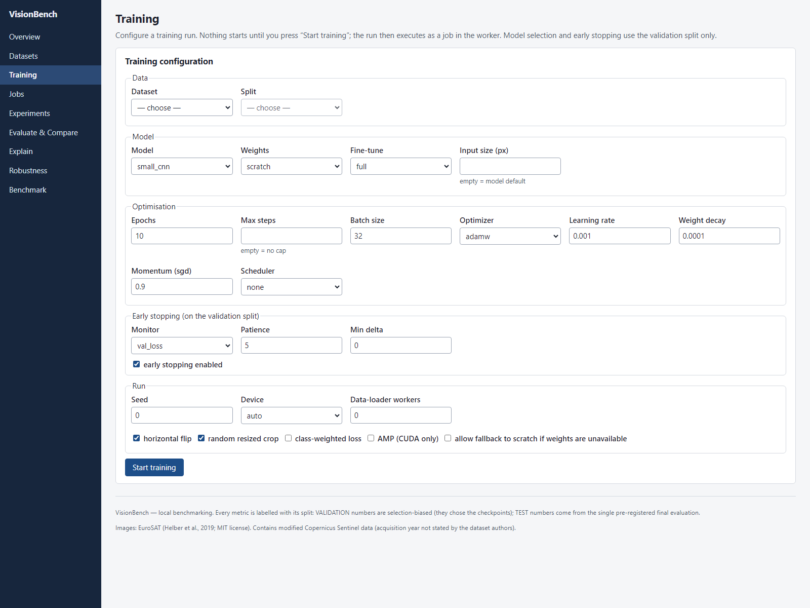 | 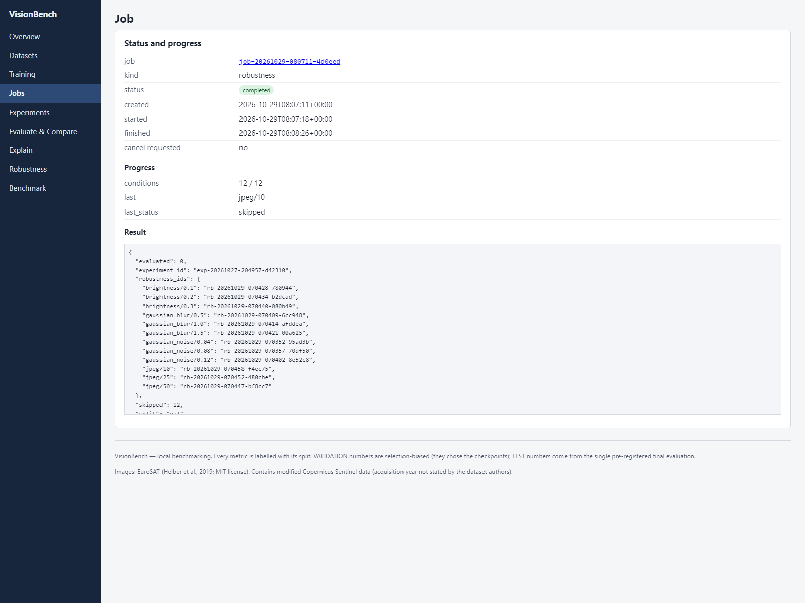 |
| 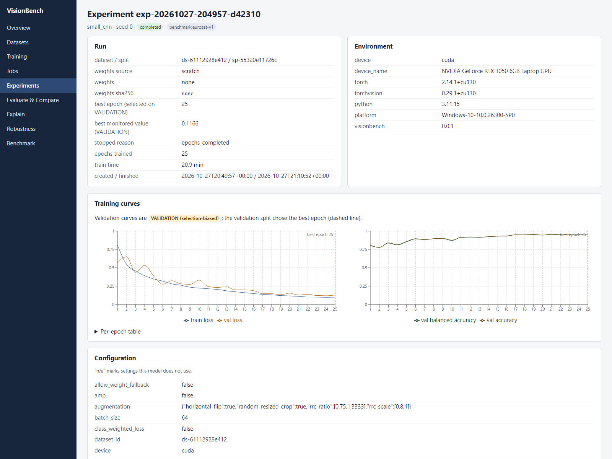 | 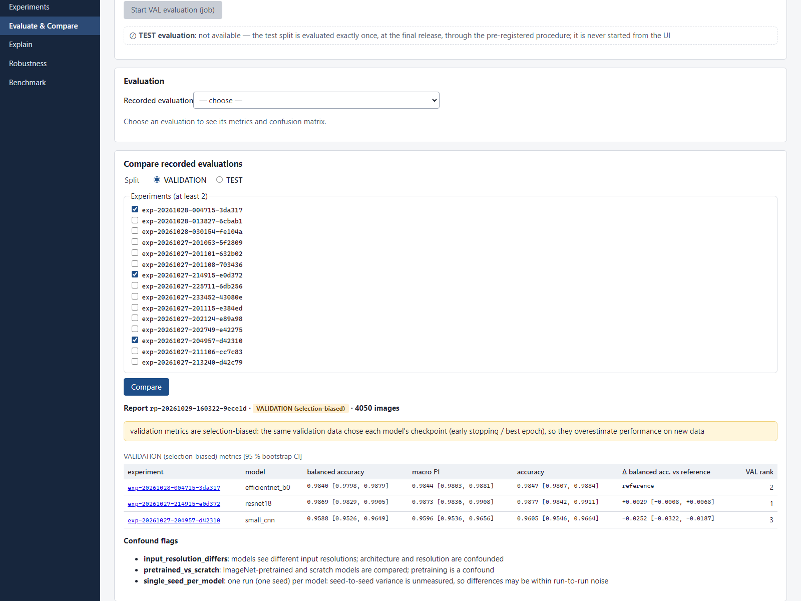 |
| 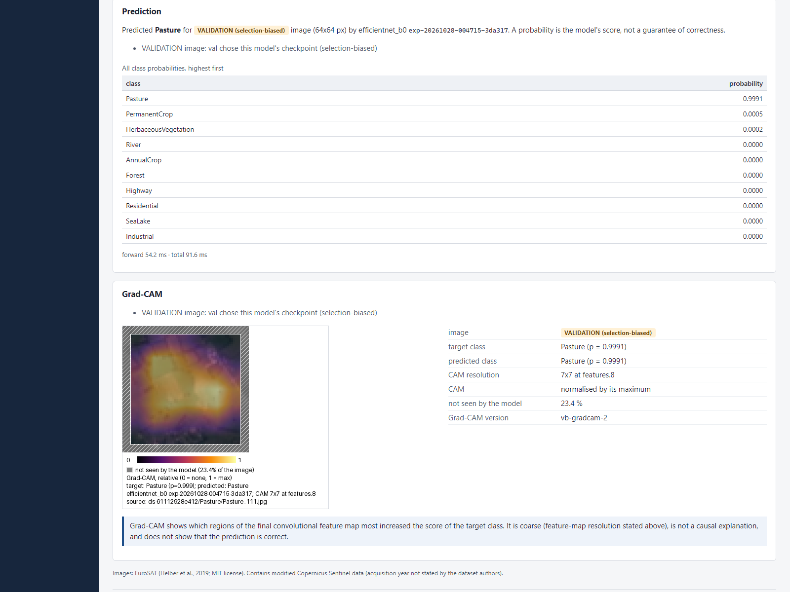 | 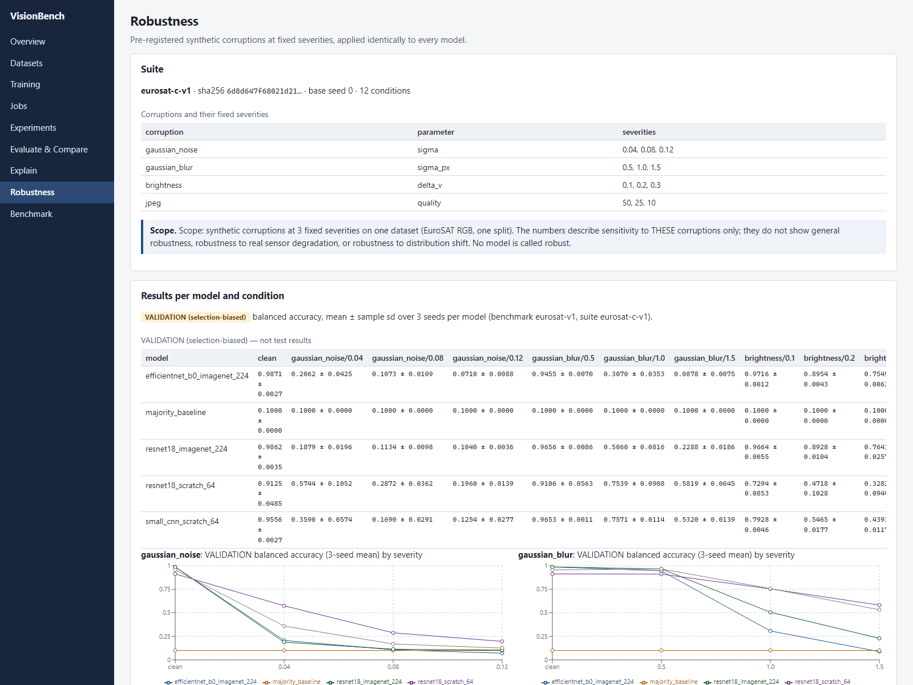 |
|  | 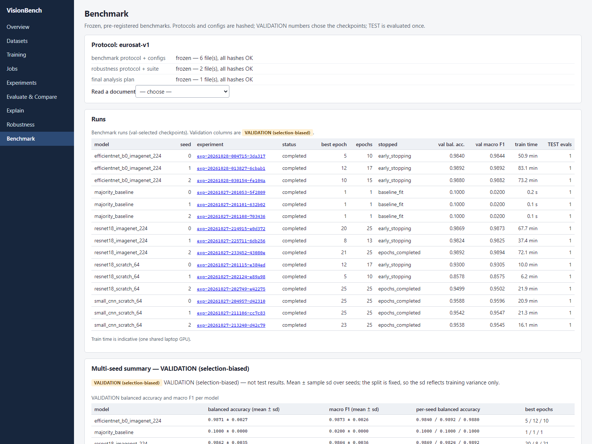 |

Images: EuroSAT (Helber et al., 2019; MIT license); contains modified Copernicus Sentinel data.

## The web app

`visionbench serve` serves the built frontend (`frontend/dist`) and the API from the same
origin on <http://127.0.0.1:8000>.

| page | what it shows |
|---|---|
| Overview | counts, benchmark hash status, the TEST lock |
| Datasets | upload a ZIP (import job), dataset detail: class chart, issues, seeded sample grid, splits, leakage audit, create split |
| Training | start a run (validated against the API's limits; never starts by itself) |
| Jobs | live progress, result, error; confirmed cancel |
| Experiments | filters, benchmark/pilot tags, config (n/a for settings a model does not use), curves with the best epoch, artifacts |
| Evaluate & Compare | start a VAL evaluation, metrics with CIs, confusion matrix, compare runs with paired differences and confound flags |
| Explain | seeded VALIDATION (or, after the final evaluation, TEST) image browser or upload → probabilities and Grad-CAM, with its limitations always visible |
| Robustness | suite, mean ± sd per model, severity charts, start a VAL robustness job |
| Benchmark | protocol hashes, documents, the 15 runs, the VALIDATION summary, the TEST section |

- **Labels:** every metric shows its split label, either "VALIDATION (selection-biased)" or "TEST".
- **TEST access:** TEST evaluation is never offered in the app. TEST images of a split are
  offered only after that split's single final evaluation (its benchmark has
  `results/FINAL_REPORT.json`); every other split stays locked.
- **Attribution:** EuroSAT attribution is shown wherever dataset tiles appear.

## Datasets

Source folder format: exactly one level of class folders. The folder name is the label.

```
my_dataset/
  cats/  img001.jpg  img002.png ...
  dogs/  a.webp  b.bmp ...
```

**What is accepted:**
- extensions (case-insensitive): `.jpg .jpeg .png .bmp .webp`;
- at least 2 classes;
- at least 3 valid images per class (configurable).

**What is reported:** anything else is reported, never silently dropped. That includes
unsupported, corrupt, truncated, empty and oversized files; hidden and system files; symlinks and
junctions (never followed); nested folders; and name collisions.

```powershell
.\.venv\Scripts\visionbench.exe dataset import C:\path\to\my_dataset --name my-dataset
.\.venv\Scripts\visionbench.exe dataset list
.\.venv\Scripts\visionbench.exe dataset verify ds-xxxxxxxxxxxx          # add --full to re-hash files
.\.venv\Scripts\visionbench.exe dataset report ds-xxxxxxxxxxxx          # add --json for everything
.\.venv\Scripts\visionbench.exe dataset split ds-xxxxxxxxxxxx --seed 42 --fractions 0.7 0.15 0.15
.\.venv\Scripts\visionbench.exe dataset audit-split ds-xxxxxxxxxxxx sp-xxxxxxxxxxxx   # leakage audit
.\.venv\Scripts\visionbench.exe demo-data var\demo                     # synthetic shapes (not EuroSAT)
```

**`import`**
- Copies accepted images into `<data_root>/datasets/<id>/raw/`.
- Writes `dataset.json`, `report.json` and `files.json`.
- Refuses to overwrite an existing dataset.
- Optional flags: `--max-image-pixels`, `--min-images-per-class`, `--dhash-threshold`,
  `--low-info-std`, `--low-info-popcount-min`, `--low-info-popcount-max`.

**`verify`**
- Checks the snapshot against `files.json`: fingerprint, file existence and sizes, and no
  unrecorded files.
- `--full` also re-hashes every file.
- Any mismatch is listed, and the command exits with code 1.

**`split`**
- Writes `<data_root>/datasets/<id>/splits/<split_id>/manifest.json`. The same dataset and config
  always produce a byte-identical manifest.
- Duplicate groups never span splits, and the manifest records a computed leakage check.
- Optional flags: `--conflict-policy exclude|error`, `--allow-missing-classes`,
  `--dhash-threshold`, `--low-info-std`, `--low-info-popcount-min`, `--low-info-popcount-max`.
- **Oversized-group warnings** are printed for multi-member groups larger than their class's val
  target or larger than 2 % of the class. They are recorded in `split_info.json`, not in the
  manifest.

**`audit-split`** re-checks a split **without trusting its duplicate grouping**.
- It decodes every image and uses an independent DCT pHash plus the dHash over all images,
  including low-information ones.
- For each val/test image it finds the nearest train image. It reports distance histograms, a
  consistency check, near misses, cross-split exact and pixel-identical matches, and group
  statistics.
- It writes `audit.json`, `audit.md`, `pairs.csv` and labelled contact sheets to
  `<data_root>/datasets/<id>/audits/<split_id>/`. The split directory is never touched.
- `--seed` (default 0) controls the sampled pairs.
- The contact sheets contain dataset images, so do not commit them.

**Everywhere:**
- Images are read with their EXIF orientation applied in the scan, hashes, training, evaluation
  and audit. Datasets imported before this change (format 1) must be re-imported.
- Errors print `error: ...` and exit with code 1. Add `--debug` for a traceback.

Real datasets used by this project, with their licenses, citations and download records, are
listed in [DATASETS.md](DATASETS.md). Dataset files are never committed.

## Training

Training is always started explicitly. A YAML config sets any `TrainConfig` field. CLI flags or
`--set key=value` override it (dotted keys, YAML values):

```yaml
# small_cnn.yaml
model: small_cnn          # majority_baseline | small_cnn | resnet18 | efficientnet_b0
weights: scratch          # imagenet (resnet18/efficientnet_b0 only) | scratch
input_size: 64
epochs: 15
batch_size: 32
optimizer: adamw          # adamw | sgd
lr: 0.001
scheduler: cosine         # none | cosine
early_stopping: {monitor: val_loss, patience: 5, min_delta: 0.0}
seed: 0
num_workers: 0
```

```powershell
.\.venv\Scripts\visionbench.exe train --config small_cnn.yaml --dataset-id ds-xxxxxxxxxxxx --split-id sp-xxxxxxxxxxxx --device cuda
.\.venv\Scripts\visionbench.exe train --dataset-id ds-... --split-id sp-... --model majority_baseline --device cpu
.\.venv\Scripts\visionbench.exe train --config cfg.yaml --set early_stopping.patience=3 --max-steps 10
.\.venv\Scripts\visionbench.exe experiments list
.\.venv\Scripts\visionbench.exe experiments show exp-YYYYMMDD-HHMMSS-xxxxxx   # add --json
```

**Before training:** the dataset is fast-verified and the manifest fingerprint is checked. Any
mismatch aborts the run.

**What a run writes:**
- `<data_root>/experiments/<exp_id>/`: `config.json`, `env.json`, `history.jsonl`, `train.log`
  and `checkpoints/`;
- rows in `<data_root>/db/visionbench.db`.

**Devices:** `--device auto|cpu|cuda`. `--amp` requires CUDA and is untested.

**Pretrained weights:**
- With `weights: imagenet`, torchvision weights are downloaded into `VISIONBENCH_TORCH_HOME`
  (default `<data_root>/cache/torch`).
- If they can't be obtained, the run fails. `--allow-weight-fallback` trains from scratch instead
  and records `weights=scratch`.

## Evaluation and comparison

```powershell
.\.venv\Scripts\visionbench.exe evaluate exp-... --split val --device cuda       # val-selected best.pt
.\.venv\Scripts\visionbench.exe evaluate exp-... --split test --device cpu       # recorded and counted
.\.venv\Scripts\visionbench.exe evaluate exp-... --split test --force --reason "fixed eval bug #12"
.\.venv\Scripts\visionbench.exe latency exp-... --device cpu                     # no split, no images
.\.venv\Scripts\visionbench.exe evaluations list [exp-...]
.\.venv\Scripts\visionbench.exe compare exp-A exp-B --split val --latency-device cpu --note "..."
.\.venv\Scripts\visionbench.exe compare exp-A exp-B --split val --eval-ids ev-... ev-...
```

**`evaluate`**
- Writes `<data_root>/experiments/<exp>/evaluations/<eval_id>/{metrics.json, predictions.csv,
  confusion_matrix.json, efficiency.json}`.
- Undefined metrics are `null` with a reason, never 0.
- CIs are 95 % percentile bootstrap (default 1000 resamples; `--bootstrap`, `--seed`).
- A **second test evaluation** of the same experiment and checkpoint is refused unless
  `--force --reason "..."` is given. The reason is stored and shown in comparison reports. The
  API applies the same rule (409 without force).

**`latency`**
- Measures the forward pass only (random input, batch 1 and 32), on one device per run.
- Needs no dataset split.
- The majority baseline has no latency.

**`compare`**
- Needs an existing evaluation of each experiment on the chosen split: the latest one, or pinned
  with `--eval-ids`.
- Refuses experiments on different datasets or splits.
- Writes `<data_root>/reports/<report_id>/comparison.{json,md}`.
- Comparisons on val state that val metrics are selection-biased.
- Ranking uses validation metrics only, and test results get no winner label.

## Reproduce the eurosat-v1 benchmark

**Sources:**
- protocol: [benchmarks/eurosat-v1/BENCHMARK_PROTOCOL.md](benchmarks/eurosat-v1/BENCHMARK_PROTOCOL.md);
- data: [DATASETS.md](DATASETS.md) (download record and checksums);
- hashes: `sha256sum -c PROTOCOL_HASHES.txt` in that folder.

**Hardware:** these commands were run on Windows 11 with a CUDA build of PyTorch (see
[Setup with CUDA](#setup-with-cuda)).

Training and validation:

```powershell
.\.venv\Scripts\visionbench.exe dataset import var\downloads\extracted\EuroSAT_RGB --name eurosat-rgb
.\.venv\Scripts\visionbench.exe dataset split ds-61112928e412 --seed 0 --dhash-threshold 5 --low-info-std 3.0 --low-info-popcount-min 8 --low-info-popcount-max 56 --conflict-policy exclude
.\.venv\Scripts\python.exe scripts\pilot_benchmark.py benchmarks\eurosat-v1
.\.venv\Scripts\python.exe scripts\run_benchmark.py train benchmarks\eurosat-v1
.\.venv\Scripts\python.exe scripts\run_benchmark.py evaluate-val benchmarks\eurosat-v1
.\.venv\Scripts\python.exe scripts\run_benchmark.py latency benchmarks\eurosat-v1
.\.venv\Scripts\visionbench.exe compare <seed-0 exp ids, protocol order> --split val --eval-ids <their val eval ids> --latency-device cuda --note "VALIDATION (selection-biased) — not test results"
.\.venv\Scripts\python.exe scripts\run_benchmark.py summary benchmarks\eurosat-v1
.\.venv\Scripts\python.exe scripts\run_benchmark.py check benchmarks\eurosat-v1
```

Robustness on VAL
([ROBUSTNESS_PROTOCOL.md](benchmarks/eurosat-v1/robustness/ROBUSTNESS_PROTOCOL.md)):

```powershell
.\.venv\Scripts\visionbench.exe robustness materialize ds-61112928e412 sp-55320e11726c --suite benchmarks/eurosat-v1/robustness/robustness_suite.yaml --split val
.\.venv\Scripts\python.exe scripts\run_robustness.py benchmarks/eurosat-v1 --split val
.\.venv\Scripts\visionbench.exe robustness report --runs benchmarks/eurosat-v1/runs.json --suite benchmarks/eurosat-v1/robustness/robustness_suite.yaml --split val --out benchmarks/eurosat-v1/results/robustness_val.md
```

- Running `materialize` again verifies every corrupted file byte for byte; it never rewrites.
- `run_robustness.py` runs `visionbench robustness evaluate <exp_id> --suite ... --split val
  --clean-eval-id <pinned val evaluation> --device cuda` for each run. It is resumable.
- `--split test` is refused while the test split is locked (`VISIONBENCH_TEST_IMAGES_UNLOCKED`).
- `check` counts the TEST evaluations in the whole database. In this release candidate it
  reports 0 clean and 0 robustness TEST evaluations.

**Caveat:** training on a GPU is not bit-for-bit deterministic across machines. Expect small
differences from the recorded runs (`benchmarks/eurosat-v1/runs.json`).

## API

> **Security: local use only.**
> - The API has **no authentication**.
> - `serve` binds to `127.0.0.1` by default and refuses any non-loopback host. Do not expose it
>   on a network or put it behind a public proxy: anyone who can reach the port can upload data
>   and start jobs.
>
> **Every POST needs the header `X-VisionBench-Request: 1`.** Without it the API returns 403
> `missing_client_header`.
> - Web pages open in your browser can send requests to `127.0.0.1` too, and this header keeps
>   them out. A browser only sends a custom header to another origin after a CORS preflight, and
>   a foreign site fails that preflight.
> - A POST whose `Origin` is neither the API's own origin nor in `VISIONBENCH_CORS_ORIGINS` gets
>   403 `origin_not_allowed`.
> - A request whose `Host` is not a local name gets 400 `invalid_host`. This stops DNS-rebinding
>   pages, which send their own hostname.
> - GET requests need no header. All responses carry `X-Content-Type-Options: nosniff`.

```powershell
.\.venv\Scripts\visionbench.exe serve                 # API + frontend on http://127.0.0.1:8000, one worker
.\.venv\Scripts\visionbench.exe serve --port 8765
.\.venv\Scripts\visionbench.exe serve --no-worker     # API only ...
.\.venv\Scripts\visionbench.exe worker                # ... and the worker in another terminal
```

```text
> visionbench serve --host 0.0.0.0
error: refusing to bind to '0.0.0.0': the API has no authentication; use one of ('127.0.0.1', 'localhost', '::1')
```

Interactive API docs are generated by FastAPI at `http://127.0.0.1:8000/docs` (Swagger UI),
`/redoc` and `/openapi.json`. Endpoints (all under `/api`):

| Method | Path | What it does |
|---|---|---|
| GET | `/api/health`, `/api/ready` | liveness; readiness (data root writable, torch imports) |
| GET | `/api/overview` | counts, benchmark list, TEST lock state (for the Overview page) |
| POST | `/api/datasets/uploads` | multipart `file` (ZIP) + `name` → validated, queued import job (202) |
| POST | `/api/datasets/imports` | `{"path","name"}` import from inside `VISIONBENCH_IMPORT_ROOT` (403 if unset) |
| GET | `/api/datasets`, `/api/datasets/{id}` | list; detail with report (no source path) |
| GET | `/api/datasets/{id}/images?relpath=...` | one recorded image (lookup by record, 404 otherwise) |
| POST/GET | `/api/datasets/{id}/splits` | create split (job); list splits |
| GET | `/api/datasets/{id}/splits/{split_id}` | split detail (counts, leakage check) |
| GET | `/api/datasets/{id}/splits/{split_id}/sample` | seeded image sample of one split (`split`, `per_class`, `seed`; TEST locked) |
| GET | `/api/datasets/{id}/audit` | leakage audits of the dataset's splits |
| POST | `/api/datasets/{id}/verify` | verify job (`{"full": true}` re-hashes) |
| POST/GET | `/api/experiments` | train (job; body = `TrainConfig`); list (with benchmark/pilot tags) |
| GET | `/api/experiments/{exp_id}` | detail: config, env, epochs, artifacts, evaluations, latency |
| POST | `/api/experiments/{exp_id}/evaluations` | evaluate job (`split`, `checkpoint`, `force`, `reason`, ...) |
| POST | `/api/experiments/{exp_id}/latency` | latency job (`device`, `warmup`, `iterations`) |
| GET | `/api/evaluations`, `/api/evaluations/{eval_id}` | list (`?experiment_id=`); detail with metrics |
| POST | `/api/comparisons` | comparison report (synchronous, reads recorded predictions; 201) |
| GET | `/api/comparisons/{report_id}` | stored report |
| GET | `/api/jobs`, `/api/jobs/{job_id}` | jobs with status, progress, result, error |
| POST | `/api/jobs/{job_id}/cancel` | cancel (queued: at once; running: cooperative, then terminate) |
| POST | `/api/experiments/{exp_id}/robustness` | robustness job on every condition of a suite (`{"suite","split"}`; test locked; 202) |
| GET | `/api/robustness`, `/api/robustness/{robustness_id}` | robustness results (`?experiment_id=`); detail with metrics |
| GET | `/api/robustness-suites` | the robustness suites found by name, with their conditions |
| POST | `/api/experiments/{exp_id}/predict` | one image (upload or `{"dataset_id","relpath"}`) → class probabilities (synchronous) |
| POST | `/api/experiments/{exp_id}/gradcam` | the same, plus optional `target_class` → Grad-CAM, overlay PNG (synchronous) |
| GET | `/api/benchmarks`, `/api/benchmarks/{name}` | frozen benchmarks: hash status, runs joined with the database, VAL summary, final report (once it exists) |
| GET | `/api/benchmarks/{name}/documents/{document}` | one of a fixed list of documents (protocols, analysis plan, reports) |

Examples (PowerShell, `curl.exe`):

```powershell
curl.exe -s -H "X-VisionBench-Request: 1" -F "name=my-data" -F "file=@my_data.zip;type=application/zip" http://127.0.0.1:8000/api/datasets/uploads
curl.exe -s http://127.0.0.1:8000/api/jobs/job-YYYYMMDD-HHMMSS-xxxxxx
curl.exe -s -H "X-VisionBench-Request: 1" -H "content-type: application/json" -d '{\"seed\":0}' http://127.0.0.1:8000/api/datasets/ds-xxxxxxxxxxxx/splits
curl.exe -s -X POST -H "X-VisionBench-Request: 1" http://127.0.0.1:8000/api/jobs/job-YYYYMMDD-HHMMSS-xxxxxx/cancel
```

Without the header:

```text
> curl.exe -s -X POST http://127.0.0.1:8000/api/jobs/job-YYYYMMDD-HHMMSS-xxxxxx/cancel
{"error":{"code":"missing_client_header","message":"state-changing requests need the header 'X-VisionBench-Request: 1'"}}
```

**Jobs:**
- Long operations return `202 {"job": {...}}`. Poll `GET /api/jobs/{id}` for `status`
  (`queued|running|completed|failed|cancelled`), `progress` and `result`.
- Only one job runs at a time. More than `VISIONBENCH_MAX_QUEUED_JOBS` queued jobs → 429.

**ZIP uploads:**
- A ZIP must contain class folders at its root or inside one top folder.
- Unsafe archives are rejected with `422 archive_<code>` before anything is queued: traversal,
  absolute paths, symlinks, encryption, case collisions, zip bombs and too many members.

**The worker:**
- There is one worker per data root. It holds an OS file lock on `db/worker.lock` while it runs,
  so a second worker exits at once with `another worker is running on this data root`.
- The OS releases the lock when the worker dies, however it dies.
- If the worker is killed, the next worker start (holding the lock) at once marks every job still
  `running`, and its experiment, as `failed` (`interrupted: ...`). Jobs are not resumed
  automatically.

**Errors:** all errors use `{"error": {"code": ..., "message": ...}}`. Responses never contain
absolute paths.

### Robustness through the API

These calls were run against `visionbench serve` on the eurosat-v1 data root.
- The suite is named, never sent as a path.
- Conditions already evaluated are skipped.

```powershell
curl.exe -s -X POST http://127.0.0.1:8000/api/experiments/exp-20261027-204957-d42310/robustness -H "X-VisionBench-Request: 1" -H "Content-Type: application/json" -d '{\"suite\":\"eurosat-c-v1\",\"split\":\"val\"}'
curl.exe -s http://127.0.0.1:8000/api/jobs/job-YYYYMMDD-HHMMSS-xxxxxx
curl.exe -s "http://127.0.0.1:8000/api/robustness?experiment_id=exp-20261027-204957-d42310"
curl.exe -s http://127.0.0.1:8000/api/robustness/rb-YYYYMMDD-HHMMSS-xxxxxx
```

```text
> (same POST with "split":"test")
{"error":{"code":"test_split_locked","message":"robustness on the TEST split is locked until the final test evaluation (M8); set VISIONBENCH_TEST_IMAGES_UNLOCKED=true only then"}}
```

### Prediction and Grad-CAM (one image, synchronous)

These commands were run against the real eurosat-v1 seed-0 models (CPU inference).
- The image must be a recorded dataset image (`dataset_id` + `relpath`) or an upload (`file`).
- TEST-split images are refused until that split's final TEST evaluation is complete (the
  response below was recorded before it; `sp-55320e11726c` is now finalised).

```powershell
# a recorded VAL image
curl.exe -s -X POST http://127.0.0.1:8000/api/experiments/exp-20261027-204957-d42310/predict -H "X-VisionBench-Request: 1" -H "Content-Type: application/json" -d '{\"dataset_id\":\"ds-61112928e412\",\"relpath\":\"AnnualCrop/AnnualCrop_264.jpg\"}'
# an upload; gradcam with an explicit target class
curl.exe -s -X POST http://127.0.0.1:8000/api/experiments/exp-20261027-204957-d42310/predict -H "X-VisionBench-Request: 1" -F "file=@blue.png"
curl.exe -s -X POST http://127.0.0.1:8000/api/experiments/exp-20261027-204957-d42310/gradcam -H "X-VisionBench-Request: 1" -F "file=@blue.png" -F "target_class=SeaLake"
```

A TEST image:

```text
> curl.exe -s -X POST http://127.0.0.1:8000/api/experiments/exp-20261027-214915-e0d372/predict -H "X-VisionBench-Request: 1" -H "Content-Type: application/json" -d '{\"dataset_id\":\"ds-61112928e412\",\"relpath\":\"AnnualCrop/AnnualCrop_100.jpg\"}'
{"error":{"code":"test_split_locked","message":"this image is in the TEST split of sp-55320e11726c; test images are locked until the final test evaluation (VISIONBENCH_TEST_IMAGES_UNLOCKED)"}}
```

**`predict` returns:**
- the predicted class and all class probabilities (sorted);
- the checkpoint name and sha256;
- the input's original size and the preprocessing (the recorded val transforms);
- timings (`forward`, `model_load` on a cache miss, `total`);
- `warnings` and `notes`.

**`gradcam` adds:**
- the target class and its probability;
- the CAM's feature-map resolution and its values (0-1);
- the geometry (`unseen_fraction`, `seen_box_in_original`);
- an overlay PNG as a `data:` URI;
- a fixed limitations text. Grad-CAM is coarse, not causal, and does not show that a prediction
  is correct (EXPERIMENT_PROTOCOL.md section 13).

**Errors:**
- `403 test_split_locked`;
- `413 upload_too_large` / `image_too_large`;
- `415 unsupported_image`;
- `422 unknown_class` / `explanation_not_supported` (majority baseline);
- `429 inference_busy`.

## Docker

- **Image (`Dockerfile`):**
  - a Node 22 stage builds the frontend;
  - the runtime is `python:3.11-slim`, with CPU PyTorch from
    [requirements/lock-cpu-linux.txt](requirements/lock-cpu-linux.txt);
  - both base images are pinned by digest;
  - it runs as a non-root user (uid 10001);
  - all data lives in the `/data` volume;
  - a healthcheck polls `/api/health`.
- **`compose.yaml`** publishes the port to **127.0.0.1:8000 only**.
- **Binding inside the container:** the container runs
  `visionbench serve --host 0.0.0.0 --allow-non-loopback`.
  - The flag works only where `VISIONBENCH_CONTAINER=1`, which the image sets.
  - The Host-header allow-list still applies, so requests must use `127.0.0.1` or `localhost`.
- **No GPU:** the image has no CUDA support. For GPU training use the native setup.
- **Commands:**

```sh
docker compose up --build -d
docker compose exec visionbench visionbench demo-data /data/demo
docker compose exec visionbench visionbench dataset import /data/demo/shapes --name demo-shapes
docker compose logs -f
docker compose down            # add -v to delete the data volume
```

## Configuration

Copy `.env.example` to `.env`, or set environment variables:

| Variable | Default | Meaning |
|---|---|---|
| `VISIONBENCH_DATA_ROOT` | `./var` | Runtime data root; `datasets/`, `artifacts/`, `db/` created on demand |
| `VISIONBENCH_MAX_UPLOAD_MB` | `200` | ZIP upload size limit (413 above it, enforced while streaming) |
| `VISIONBENCH_LOG_LEVEL` | `INFO` | Log level |
| `VISIONBENCH_MAX_IMAGE_PIXELS` | `50000000` | Images with more pixels are rejected |
| `VISIONBENCH_MIN_IMAGES_PER_CLASS` | `3` | Minimum valid images per class |
| `VISIONBENCH_DHASH_THRESHOLD` | `5` | Max dHash Hamming distance for near duplicates |
| `VISIONBENCH_LOW_INFO_STD_THRESHOLD` | `3.0` | Gray std below which perceptual matching is skipped |
| `VISIONBENCH_LOW_INFO_POPCOUNT_MIN` / `_MAX` | `8` / `56` | dHash popcount outside this range skips perceptual matching |
| `VISIONBENCH_REPORT_SAMPLES_PER_CLASS` | `8` | Seeded sample size per class in `report.json` |
| `VISIONBENCH_CONFLICT_POLICY` | `exclude` | Label-conflict duplicate groups: `exclude` or `error` |
| `VISIONBENCH_TORCH_HOME` | `<data_root>/cache/torch` | torch hub dir for pretrained weights |
| `VISIONBENCH_API_HOST` / `_API_PORT` | `127.0.0.1` / `8000` | `serve` bind address (loopback only) |
| `VISIONBENCH_CORS_ORIGINS` | `["http://localhost:5173","http://127.0.0.1:5173"]` | Browser origins allowed besides the API's own (JSON list; the Vite dev server) |
| `VISIONBENCH_EXTRA_TRUSTED_HOSTS` | `[]` | `Host` names accepted besides `localhost`, `127.0.0.1`, `[::1]` (JSON list) |
| `VISIONBENCH_MAX_QUEUED_JOBS` | `10` | Queued jobs before `429 queue_full` |
| `VISIONBENCH_WORKER_POLL_SECONDS` | `0.5` | Worker queue poll interval |
| `VISIONBENCH_WORKER_HEARTBEAT_SECONDS` | `2.0` | Heartbeat interval while a job runs |
| `VISIONBENCH_CANCEL_TIMEOUT_SECONDS` | `30.0` | After a cancel request, terminate the job's process after this long |
| `VISIONBENCH_IMPORT_ROOT` | unset | Enables `POST /api/datasets/imports`, confined to this folder |
| `VISIONBENCH_ZIP_MAX_MEMBERS` | `50000` | Max ZIP members |
| `VISIONBENCH_ZIP_MAX_UNCOMPRESSED_MB` | `4096` | Max total uncompressed ZIP size |
| `VISIONBENCH_ZIP_MAX_RATIO` | `100` | Max compression ratio (zip-bomb guard) |
| `VISIONBENCH_INFERENCE_DEVICE` | `cpu` | `cpu`, `cuda` or `auto` for predict / gradcam (CPU keeps the GPU free for training) |
| `VISIONBENCH_INFERENCE_THREADS` | unset | torch intra-op threads in the API process |
| `VISIONBENCH_INFERENCE_CACHE_SIZE` | `2` | Loaded models kept (LRU) |
| `VISIONBENCH_INFERENCE_MAX_CONCURRENT` | `1` | Inference requests running at once |
| `VISIONBENCH_INFERENCE_WAIT_SECONDS` | `2.0` | Wait for a free slot, then `429 inference_busy` |
| `VISIONBENCH_INFERENCE_MAX_UPLOAD_MB` | `10` | Image upload limit for predict / gradcam |
| `VISIONBENCH_ROBUSTNESS_SUITES_DIR` | `benchmarks` | Where robustness suites (`robustness_suite*.yaml`) are looked up by name |
| `VISIONBENCH_BENCHMARKS_DIR` | `benchmarks` | Frozen benchmark folders shown read-only by the app |
| `VISIONBENCH_FRONTEND_DIST` | `frontend/dist` | Built frontend served by `serve` (if it exists) |
| `VISIONBENCH_TEST_IMAGES_UNLOCKED` | `false` | Allow TEST-split images in predict / gradcam and TEST robustness; set only after the final test evaluation |
| `VISIONBENCH_CONTAINER` | unset | Set to `1` by the Docker image; only then does `serve --allow-non-loopback` work |

## Development

### Setup with CUDA

**What was used here:** this project was developed on Windows 11 with Python 3.11.15 and an
RTX 3050 6 GB (driver CUDA 13.4).

**Lock files:**
- [requirements/lock-dev-cu130.txt](requirements/lock-dev-cu130.txt): the exact versions of
  that environment;
- [requirements/lock-cpu-linux.txt](requirements/lock-cpu-linux.txt) and
  [lock-dev-cpu-linux.txt](requirements/lock-dev-cpu-linux.txt): Linux CPU, generated by
  `scripts/lock_cpu_linux.sh` in the Docker base image.

```powershell
py -3.11 -m venv .venv
.\.venv\Scripts\python.exe -m pip install torch torchvision --index-url https://download.pytorch.org/whl/cu130
.\.venv\Scripts\python.exe -m pip install -e ".[dev]"
```

### Backend tests and lint

```powershell
.\.venv\Scripts\ruff.exe check .
.\.venv\Scripts\ruff.exe format --check .
.\.venv\Scripts\pytest.exe -q --cov=visionbench
```

**Running with the GPU hidden:**
- In Windows PowerShell 5.1, use `$env:CUDA_VISIBLE_DEVICES="-1"`.
- `$env:CUDA_VISIBLE_DEVICES=""` deletes the variable instead of setting it, so the GPU stays
  visible.
- The pytest summary prints `torch.cuda.is_available()` for every run.

**Linux (POSIX file lock, process handling)** in the pinned Python image, as a non-root user:

```sh
git archive HEAD | tar -x -C /tmp/vb-export
docker run --rm -v /tmp/vb-export:/src:ro -v vb-pip-cache:/pip-cache python:3.11-slim@sha256:673719e071ecf27434fd2635bbd8d00f49f4fdd81f243143438a42ced8bedf60 sh /src/scripts/linux_tests.sh
```

### Frontend

The frontend lives in `frontend/`. It uses React 18, TypeScript (strict), Vite, React Router,
TanStack Query and Recharts. Tests use Vitest, Testing Library and MSW; the end-to-end test uses
Playwright.

```powershell
cd frontend
npm ci
npm run dev            # http://127.0.0.1:5173, proxies /api to VISIONBENCH_API_URL or http://127.0.0.1:8000
npm run lint           # ESLint + Prettier check
npm run typecheck
npm run test           # unit/component tests (MSW); test:coverage for coverage
npm run build          # -> frontend/dist, served by `visionbench serve`
npm run gen:api        # regenerate src/api/schema.d.ts from the FastAPI OpenAPI schema
npm run check:api      # fails if src/api/schema.d.ts is stale
npx playwright install chromium   # once
npm run e2e            # real backend on a temporary data root with synthetic data
```

**What the e2e test does:**
- It starts `scripts/e2e_backend.py`, which gives `visionbench serve` a fresh temporary data root,
  a generated shapes ZIP and a small robustness suite.
- In the browser it goes through upload, split, training, VAL evaluation, compare, predict and
  Grad-CAM, a locked TEST image, robustness and cancel.
- Build the frontend before running it.

**Dev-server requests:** they come from `http://127.0.0.1:5173` (in `VISIONBENCH_CORS_ORIGINS`
by default), and the API client sends `X-VisionBench-Request: 1` on every mutation.

### CI

**What `.github/workflows/ci.yml` runs:**
- backend: ruff, pytest with coverage, protocol hashes;
- frontend: lint, typecheck, tests, build;
- e2e: the API-types check and Playwright;
- docker: build and a health check.

**It has not run on GitHub Actions:** the repository has no remote. Its steps were run locally:
the backend suite on Windows and in the Linux container, the frontend checks and e2e on Windows,
and the Docker build.

## Troubleshooting

| symptom | cause / fix |
|---|---|
| `403 missing_client_header` | add `X-VisionBench-Request: 1` to every POST |
| `403 origin_not_allowed` | the request comes from a page that is neither the API's own origin nor in `VISIONBENCH_CORS_ORIGINS` |
| `400 invalid_host` | use `127.0.0.1` or `localhost`; other host names need `VISIONBENCH_EXTRA_TRUSTED_HOSTS` |
| `403 test_split_locked` | intended: TEST images and TEST robustness are locked until the final test evaluation |
| `429 inference_busy` | one predict/Grad-CAM request at a time; retry after it finishes |
| `429 queue_full` | too many queued jobs (`VISIONBENCH_MAX_QUEUED_JOBS`) |
| `another worker is running on this data root` | a second `serve`/`worker` on the same data root; stop the first one |
| `http://127.0.0.1:8000/` returns `{"error":{"code":"http_404",...}}` | the frontend is not built, or `serve` was started outside the repository root (`frontend/dist` is relative to the working directory): run `npm ci && npm run build` in `frontend/`, or set `VISIONBENCH_FRONTEND_DIST` |
| jobs stay `queued` | `serve --no-worker` without a separate `visionbench worker` |
| pretrained training fails offline | ImageNet weights are downloaded on first use; pre-fill `VISIONBENCH_TORCH_HOME` or use `--allow-weight-fallback` |
| GPU still used with `$env:CUDA_VISIBLE_DEVICES=""` | PowerShell deletes the variable; use `"-1"` |
| Docker: `failed to connect to the docker API` | start Docker Desktop (or the Docker daemon) first |
| Git Bash on Windows: `docker compose exec ... /data/demo` fails with `C:/Program Files/Git/data/...` | Git Bash rewrites `/data/...` arguments into Windows paths; prefix the command with `MSYS_NO_PATHCONV=1`, or use PowerShell |
| Windows: `python -m venv` fails in `ensurepip` with `[WinError 3] The system cannot find the path specified` | the clone's path is too long for the 260-character limit (pip's own files are deeply nested); clone into a short path such as `C:\Users\<you>\vb`, or enable Windows long paths (admin) |

## Limitations

**Security and scale:**
- There is no authentication. The app is for one user on one machine (loopback only).
- There is one worker, so one job runs at a time. There is no distributed training.

**Models and data:**
- The task is image classification only (single label, folder-per-class datasets).
- Grad-CAM is coarse, not a causal explanation, and does not show that a prediction is correct.
- Robustness uses 12 fixed synthetic corruption conditions. They are not natural distribution
  shift.

**The eurosat-v1 benchmark** (see BENCHMARK_PROTOCOL.md and EXPERIMENT_PROTOCOL.md):
- it uses one split and n = 3 seeds;
- it has an epoch cap, and learning rates were not tuned;
- input resolution is confounded with pretraining;
- some EuroSAT tiles carry very little information (very dark or uniform).

**Environment:**
- Only Windows 11 + CUDA (development) and Linux CPU (container) were exercised.
- macOS and Python 3.12/3.13 have not been tested.

## License and attribution

- **VisionBench:** MIT License, Copyright (c) 2026 Jaswant Raj ([LICENSE](LICENSE)).
- **EuroSAT** (Helber et al., 2019) is used under the MIT license and contains modified
  Copernicus Sentinel data. The citation, license and download record are in
  [DATASETS.md](DATASETS.md). Dataset files are never committed.
- **Third-party packages** are listed in the lock files under `requirements/` and in
  `frontend/package-lock.json`, each under its own license.

## Docs

[ARCHITECTURE.md](ARCHITECTURE.md) · [EXPERIMENT_PROTOCOL.md](EXPERIMENT_PROTOCOL.md) ·
[DATASETS.md](DATASETS.md) · [PROJECT_STATUS.md](PROJECT_STATUS.md) ·
[CHANGELOG.md](CHANGELOG.md) · [IMPLEMENTATION_PLAN.md](IMPLEMENTATION_PLAN.md) ·
[DEFINITION_OF_DONE.md](DEFINITION_OF_DONE.md) ·
[FINAL_REPORT.md](benchmarks/eurosat-v1/results/FINAL_REPORT.md)
